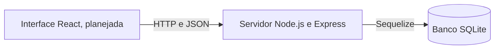
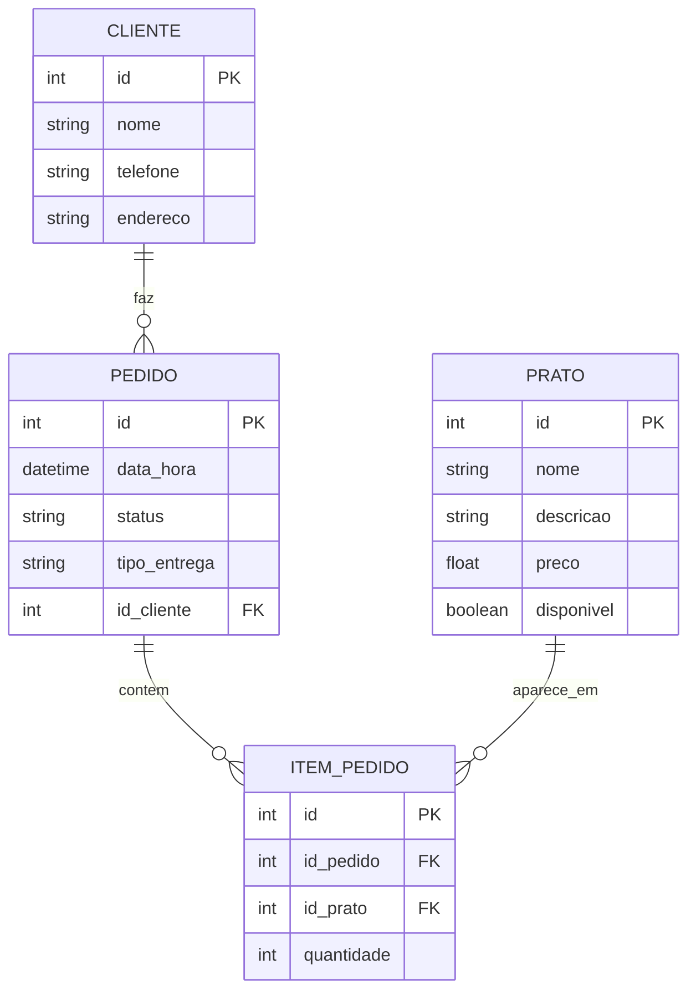

# Restaurante On-line

Sistema inicial de restaurante on-line para consultar o cardápio, fazer pedidos para entrega ou retirada e permitir que a equipe do restaurante administre pratos e acompanhe o andamento dos pedidos.

Este documento reúne o fluxo e os requisitos apresentados no arquivo do projeto com as rotas que já existem em `backend/index.js`. Ele diferencia o que o código já oferece do que ainda depende de telas, contas de acesso ou permissões.

## Objetivos do projeto

O sistema deve conduzir o pedido pelas seguintes etapas:

1. O visitante consulta os pratos disponíveis.
2. O cliente informa nome, telefone e endereço.
3. O cliente escolhe pratos e quantidades e seleciona entrega ou retirada.
4. A API grava o pedido e todos os itens no SQLite em uma única transação.
5. A equipe do restaurante consulta o pedido, o cliente, os pratos e as quantidades.
6. A equipe atualiza o status, e o cliente acompanha o andamento usando seu identificador.

A apresentação propõe uma interface web em React, uma API em Node.js e Express e um banco SQLite acessado pelo Sequelize. As tarefas exclusivas do proprietário/equipe devem ser feitas pelo Back Office (BKO): o painel administrativo que consome as rotas da API. Este repositório contém a implementação do servidor; o painel BKO e a interface de cliente em React ainda não estão incluídos.

## Histórias de usuário e funcionalidades

“Eu posso” descreve uma ação que cada tipo de usuário espera realizar. A coluna de situação informa o que a API atual realmente oferece.

| Tipo de usuário | História de usuário / Eu posso | Funcionalidade no servidor | Rota(s) da API | Situação atual |
|---|---|---|---|---|
| Visitante | Eu posso consultar o cardápio e ver nome, descrição e preço dos pratos. | Lista pratos disponíveis e consulta um prato pelo identificador. | `GET /pratos`, `GET /pratos/:id` | Implementado. A listagem padrão oculta pratos indisponíveis. |
| Visitante | Eu posso informar meus dados antes de finalizar um pedido. | Salva nome, telefone e endereço do cliente. | `POST /clientes` | Implementado como registro no banco; não há senha nem início de sessão. |
| Cliente cadastrado | Eu posso fazer um pedido com um ou mais pratos e suas quantidades. | Valida cliente, disponibilidade dos pratos, modalidade e quantidades; grava pedido e itens em uma transação. | `POST /pedidos` | Implementado. A requisição precisa de um `id_cliente` já existente. |
| Cliente cadastrado | Eu posso escolher entrega ou retirada para meu pedido. | Salva `tipo_entrega` como `entrega` ou `retirada`. | `POST /pedidos` | Implementado. Na entrega, usa o endereço salvo no cadastro do cliente. |
| Cliente cadastrado | Eu posso consultar e atualizar meus dados de contato e entrega. | Lê ou altera os dados do cliente pelo identificador. | `GET /clientes/:id`, `PUT /clientes/:id` | Implementado por identificador; a identidade de quem consulta não é confirmada. |
| Cliente cadastrado | Eu posso consultar meu histórico e acompanhar o status dos pedidos. | Lista os pedidos de um identificador de cliente, do mais recente ao mais antigo, com pratos e quantidades. | `GET /clientes/:id/pedidos` | Implementado por identificador; não há verificação de que a pessoa é dona desse cadastro. |
| Cliente cadastrado | Eu posso cancelar um pedido. | Altera o status para `cancelado` e preserva o histórico do pedido. | `DELETE /pedidos/:id` | Implementado. Apesar do método HTTP, a rota cancela o pedido em vez de apagá-lo. |
| Proprietário / Equipe do restaurante (Back Office/BKO) | No BKO, eu posso cadastrar, editar e remover pratos do cardápio. | O BKO usa a API para cadastrar, consultar todos os pratos (inclusive indisponíveis), editar dados e disponibilidade, ou excluir pratos sem histórico de pedidos. | `POST /pratos`, `GET /pratos?todos=true`, `GET /pratos/:id`, `PUT /pratos/:id`, `DELETE /pratos/:id` | As operações da API estão implementadas para integração com o BKO. A interface BKO ainda precisa ser criada e conectada; não há login ou autorização, então essas rotas ainda não são restritas ao proprietário/equipe. Um prato ligado ao histórico não pode ser apagado; marque-o como indisponível. |
| Proprietário / Equipe do restaurante | Eu posso consultar os pedidos recebidos, com cliente, pratos e quantidades. | Lista pedidos com seus dados relacionados. | `GET /pedidos`, `GET /pedidos/:id` | Implementado. As rotas ainda não exigem acesso da equipe. |
| Proprietário / Equipe do restaurante | Eu posso atualizar o andamento do pedido. | Altera o status para um dos valores aceitos. | `PUT /pedidos/:id` | Implementado. Os valores estão na seção [Status dos pedidos](#status-dos-pedidos). |
| Proprietário / Equipe do restaurante | Eu posso consultar e corrigir os itens de um pedido. | Lista, consulta, adiciona, altera e exclui itens. | Rotas `/itens-pedido` | Implementado com operações de cadastro, consulta, alteração e exclusão. |

### Back Office (BKO) e limitação de contas e permissões

O BKO é a área administrativa destinada ao proprietário/equipe para gerenciar pratos e pedidos. Nesta etapa, o backend oferece as rotas que o BKO deverá consumir, mas a interface do painel ainda não existe neste repositório. Os tipos de usuário descrevem o uso pretendido. **O servidor ainda não implementa contas, senhas, sessões, tokens ou permissões por função.** Um “cliente cadastrado” é apenas uma linha na tabela `Clientes`, e não uma pessoa que entrou em uma conta. A API não diferencia visitante, cliente e funcionário do restaurante.

Por isso, qualquer pessoa que consiga acessar a API pode consultar todos os pedidos e clientes, enviar um pedido informando um `id_cliente` existente, alterar pratos e atualizar status. O campo `id_cliente` confirma apenas que o cadastro existe; **não prova que a requisição foi feita por aquele cliente**. Assim, a regra “somente cliente cadastrado” ainda não é aplicada por login. Implemente autenticação e autorização antes de usar dados reais de clientes ou disponibilizar operações exclusivas do restaurante na internet.

## Arquitetura do sistema



Por padrão, a API Express usa a porta `8080`. O arquivo `restaurante.db` fica ao lado de `backend/index.js`, independentemente da pasta de onde o Node.js foi iniciado.

### Integração com React (CORS)

A API aceita por padrão requisições de desenvolvimento originadas em `http://localhost:3000` e `http://localhost:5173` (portas comuns do React). Para outros endereços, configure `CORS_ORIGINS` como uma lista separada por vírgulas contendo as origens completas, incluindo protocolo e porta. Exemplo no WSL:

```bash
CORS_ORIGINS=http://localhost:5173,http://localhost:3000 node index.js
```

As requisições `OPTIONS` de preflight são atendidas e os métodos `GET`, `POST`, `PUT` e `DELETE` aceitam `Content-Type` e `Authorization`. A API não habilita credenciais/cookies. O navegador pode bloquear origens que não estejam na lista.

## Modelo de dados

O banco segue as quatro tabelas da apresentação. O Sequelize também cria os campos `id`, `createdAt` e `updatedAt` para cada modelo.

| Tabela / modelo | Campos no servidor | Finalidade |
|---|---|---|
| `Cliente` | `id`, `nome`, `telefone`, `endereco`, datas de criação e alteração | Dados de contato e endereço de entrega salvo do cliente. |
| `Prato` | `id`, `nome`, `descricao`, `preco`, `disponivel`, datas de criação e alteração | Pratos do cardápio e indicação de disponibilidade para pedidos. |
| `Pedido` | `id`, `data_hora`, `status`, `tipo_entrega`, `id_cliente`, datas de criação e alteração | Cliente, horário, andamento e escolha entre entrega e retirada. |
| `ItemPedido` | `id`, `id_pedido`, `id_prato`, `quantidade`, datas de criação e alteração | Relação entre pedidos e pratos, com a quantidade solicitada. |



`tipo_entrega` é um campo adicional necessário para representar a escolha entre entrega e retirada. Ao iniciar, o servidor adiciona essa coluna à tabela `Pedidos` caso ela ainda não exista. Registros antigos podem ficar sem esse valor; novos pedidos precisam informá-lo.

## Status dos pedidos

| Valor | Significado |
|---|---|
| `recebido` | A API gravou o pedido. É o status inicial. |
| `em_preparacao` | A equipe do restaurante está preparando o pedido. |
| `saiu_para_entrega` | O pedido está a caminho do cliente. |
| `concluido` | O pedido foi concluído. |
| `cancelado` | O pedido foi cancelado. Seus dados permanecem no banco. |

`PUT /pedidos/:id` aceita somente esses valores. O código valida se o valor está na lista, mas não exige uma sequência específica de transições.

## Referência da API

Todas as rotas recebem e retornam JSON, exceto quando indicado. Atualmente, **nenhuma rota é protegida por login ou função de usuário**. A coluna “uso previsto” indica a finalidade, não uma regra de acesso aplicada pelo código.

### Verificação do servidor

| Método | Caminho | Uso previsto | Observações |
|---|---|---|---|
| `GET` | `/` | Verificar se o processo da API responde. | Retorna uma mensagem em texto simples. |

### Pratos (`pratos`)

| Método | Caminho | Uso previsto | Observações |
|---|---|---|---|
| `POST` | `/pratos` | BKO: proprietário/equipe cadastra um prato. | Exige `nome` e `preco`; `disponivel` assume `true` por padrão. |
| `GET` | `/pratos` | Visitante consulta o cardápio. | Retorna somente pratos disponíveis. |
| `GET` | `/pratos?todos=true` | BKO: proprietário/equipe consulta todos os pratos. | Inclui pratos indisponíveis; ainda não exige permissão. |
| `GET` | `/pratos/:id` | BKO consulta um prato pelo identificador para exibição ou edição. | Retorna `404` quando o prato não existe. |
| `PUT` | `/pratos/:id` | BKO: proprietário/equipe altera um prato ou sua disponibilidade. | Campos aceitos: `nome`, `descricao`, `preco`, `disponivel`. Para marcar como indisponível, envie `{"disponivel":false}`. |
| `DELETE` | `/pratos/:id` | BKO: proprietário/equipe exclui um prato. | Retorna `409` se houver pedidos relacionados. Para retirá-lo do cardápio sem perder o histórico, altere `disponivel` para `false`. |

Exemplo de dados para cadastrar um prato:

```json
{
  "nome": "Feijoada",
  "descricao": "Prato individual",
  "preco": 35.5,
  "disponivel": true
}
```

### Clientes (`clientes`)

| Método | Caminho | Uso previsto | Observações |
|---|---|---|---|
| `POST` | `/clientes` | Criar o registro do cliente antes do pedido. | Exige `nome`, `telefone` e `endereco`; retorna o `id` gerado. |
| `GET` | `/clientes` | Proprietário/equipe consulta clientes. | Retorna todos os registros; a rota ainda é pública. |
| `GET` | `/clientes/:id` | Consultar os dados de um cliente. | Retorna `404` se o cadastro não existir. |
| `GET` | `/clientes/:id/pedidos` | Cliente acompanha seus pedidos. | Filtra pelo identificador enviado e inclui itens e pratos; não confirma a identidade do solicitante. |
| `PUT` | `/clientes/:id` | Alterar contato ou endereço do cliente. | Campos aceitos: `nome`, `telefone`, `endereco`. |
| `DELETE` | `/clientes/:id` | Excluir um cadastro de cliente. | Não permite a exclusão quando há pedidos relacionados. |

### Pedidos (`pedidos`)

| Método | Caminho | Uso previsto | Observações |
|---|---|---|---|
| `POST` | `/pedidos` | Cliente envia um pedido. | Cria pedido e itens em uma transação. Exige cliente existente, ao menos um item, pratos disponíveis, quantidades inteiras positivas e modalidade de entrega ou retirada. |
| `GET` | `/pedidos` | Proprietário/equipe consulta pedidos recebidos. | Inclui cliente, pratos e quantidades; ainda é uma rota pública. |
| `GET` | `/pedidos/:id` | Consultar um pedido. | Inclui cliente, itens e pratos. |
| `PUT` | `/pedidos/:id` | Proprietário/equipe atualiza o andamento. | O corpo precisa conter um `status` aceito. Esta rota não altera outros campos do pedido. |
| `DELETE` | `/pedidos/:id` | Cancelar um pedido. | Define o status `cancelado`; não apaga o pedido nem seus itens. |

Exemplo de pedido:

```json
{
  "id_cliente": 1,
  "tipo_entrega": "entrega",
  "itens": [
    { "id_prato": 2, "quantidade": 2 },
    { "id_prato": 5, "quantidade": 1 }
  ]
}
```

Use `"tipo_entrega": "retirada"` quando o cliente for buscar o pedido. Para entrega, o servidor usa o `endereco` salvo no cadastro do cliente; o pedido não guarda uma cópia separada do endereço.

Exemplo de alteração de status:

```json
{
  "status": "em_preparacao"
}
```

### Itens do pedido (`itens-pedido`)

Estas rotas oferecem as operações CRUD exigidas e permitem correções pela equipe. No fluxo normal de compra, use `POST /pedidos`, que grava o pedido e todos os itens na mesma transação.

| Método | Caminho | Uso previsto | Observações |
|---|---|---|---|
| `POST` | `/itens-pedido` | Adicionar item a um pedido existente. | Exige `id_pedido`, `id_prato` e `quantidade` inteira positiva. |
| `GET` | `/itens-pedido` | Consultar itens. | Inclui os dados do pedido e do prato relacionados. |
| `GET` | `/itens-pedido/:id` | Consultar um item. | Inclui os dados do pedido e do prato. |
| `PUT` | `/itens-pedido/:id` | Corrigir o pedido, prato ou quantidade de um item. | A quantidade deve ser um inteiro positivo. |
| `DELETE` | `/itens-pedido/:id` | Excluir um item. | Retorna `404` se ele não existir. |

## Validações e respostas de erro

A API valida identificadores positivos, corpos JSON em formato de objeto, dados dos itens, disponibilidade dos pratos no momento do pedido, modalidade de entrega ou retirada, status e quantidades inteiras positivas. As respostas principais são:

| Código HTTP | Significado |
|---|---|
| `201` | Prato, cliente, pedido ou item criado. |
| `200` | Consulta, alteração, cancelamento ou exclusão concluída. |
| `400` | Dados enviados são inválidos. |
| `404` | Registro solicitado não existe. |
| `409` | Um registro relacionado impede a exclusão solicitada. |
| `500` | Ocorreu um erro inesperado no servidor. |

A criação de um pedido usa uma transação do banco de dados. Se a validação ou gravação de qualquer item falhar, o pedido e todos os seus itens são desfeitos juntos.

## Como iniciar o servidor

Requisitos: uma instalação compatível do Node.js e o `npm` funcionando para instalar as dependências, incluindo o módulo nativo do SQLite.

No terminal do WSL:

```bash
cd backend
npm install
node index.js
```

Por padrão, a API fica disponível em `http://localhost:8080`. Para usar outra porta no WSL:

```bash
PORT=8081 node index.js
```

O banco de dados será criado em `backend/restaurante.db`. O arquivo `.gitignore` exclui arquivos `.db` para evitar que dados locais de clientes e pedidos sejam enviados ao repositório sem querer. O Sequelize cria tabelas ausentes ao iniciar, e o servidor adiciona `tipo_entrega` se a tabela `Pedidos` antiga ainda não tiver essa coluna.

Ainda não existe uma bateria de testes automatizados. O script `test` em `backend/package.json` é apenas um exemplo provisório.

## Limites da implementação atual

- As telas React, o carrinho de pedidos, as telas de acesso e o painel Back Office (BKO) aparecem na apresentação, mas não estão incluídos neste repositório. As rotas de gestão de pratos e pedidos são a camada de API para o futuro BKO.
- Não foram implementados acesso por conta, armazenamento de senhas, sessões, tokens nem permissões entre cliente e equipe.
- Não há pagamento, controle de quantidade em estoque, entregador designado, previsão de entrega, notificações por mensagem ou atualização imediata da tela.
- O acompanhamento do cliente é uma consulta HTTP; a interface precisará consultar novamente a rota para exibir mudanças de status.
- Os pedidos guardam pratos e quantidades, mas não registram o preço praticado no momento da compra nem o valor total. Se o preço do cardápio mudar, a interface poderá exibir outro valor ao consultar o pedido, a menos que o preço seja salvo no pedido ou o modelo do banco seja ampliado.
- Como ainda não há autenticação, não exponha a API publicamente com dados reais de clientes.

## Observação sobre a execução

O código passa na verificação de sintaxe `node --check`, mas o ambiente de desenvolvimento usado na revisão não conseguiu iniciar a API: o módulo nativo `sqlite3` instalado informou que não era um aplicativo Win32 válido. Isso indica um problema local de dependência ou compatibilidade, e não confirma que a conexão com o banco foi executada com sucesso. Reinstale ou reconstrua as dependências no ambiente Windows/Node.js de destino; depois, inicie o servidor e confirme a rota inicial e as consultas que acessam o banco.
