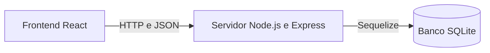
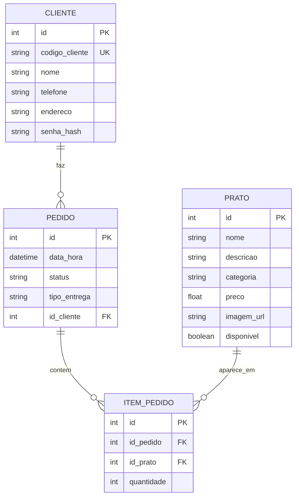

# Restaurante On-line

Sistema inicial de restaurante on-line para consultar o cardápio, fazer pedidos para entrega ou retirada e permitir que a equipe do restaurante administre pratos e acompanhe o andamento dos pedidos.

Este documento reúne o fluxo e os requisitos apresentados no arquivo do projeto com as rotas que já existem em `backend/index.js`. Ele diferencia o que o código já oferece do que ainda depende de telas, contas de acesso ou permissões.

## Objetivos do projeto

O sistema deve conduzir o pedido pelas seguintes etapas:

1. O visitante consulta os pratos disponíveis.
2. O cliente informa nome, telefone e endereço.
3. O cliente escolhe pratos e quantidades e seleciona entrega ou retirada.
4. A API grava o pedido e todos os itens no SQLite em uma única transação.
5. A equipe do restaurante consulta o pedido, o cliente, os pratos e as quantidades.
6. A equipe atualiza o status, e o cliente acompanha o andamento usando seu identificador.

A apresentação propõe uma interface web em React, uma API em Node.js e Express e um banco SQLite acessado pelo Sequelize. As tarefas exclusivas do proprietário/equipe devem ser feitas pelo Back Office (BKO): o painel administrativo que consome as rotas da API. Este repositório contém o backend e a interface React inicial em frontend/. O painel BKO e a experiência do cliente estão reunidos nessa aplicação.

## Histórias de usuário e funcionalidades

“Eu posso” descreve uma ação que cada tipo de usuário espera realizar. A coluna de situação informa o que a API atual realmente oferece.

| Tipo de usuário | História de usuário / Eu posso | Funcionalidade no servidor | Rota(s) da API | Situação atual |
|---|---|---|---|---|
| Visitante | Eu posso consultar o cardápio e ver nome, descrição e preço dos pratos. | Lista pratos disponíveis e consulta um prato pelo identificador. | `GET /pratos`, `GET /pratos/:id` | Implementado. A listagem padrão oculta pratos indisponíveis. |
| Visitante | Eu posso conhecer os pratos em destaque e abrir os detalhes de um prato. | Classifica pratos disponíveis por unidades vendidas e apresenta fotos, descrição e preço. | `GET /pratos/destaques` | Implementado no cardápio com destaque rotativo. |
| Visitante | Eu posso montar uma sacola e consultar o cardápio sem entrar. | Mantém itens no navegador; exige conta para checkout e acompanhamento. | `GET /pratos` | Implementado no frontend. Visitantes não acessam a área “Meus pedidos” sem entrar. |
| Visitante | Eu posso criar uma conta para fazer pedidos. | Salva dados do cliente e hash de senha, retorna código e token de sessão. | `POST /auth/register` | Implementado; senha mínima de 8 caracteres. |
| Cliente cadastrado | Eu posso entrar na minha conta e acompanhar meus pedidos. | Emite token assinado e retorna somente o histórico da conta autenticada. | `POST /auth/login`, `GET /minha-conta/pedidos` | Implementado; exige código de cliente e senha. |
| Cliente cadastrado | Eu posso fazer um pedido com um ou mais pratos e suas quantidades. | Valida cliente, disponibilidade dos pratos, modalidade e quantidades; grava pedido e itens em uma transação. | `POST /pedidos` | Implementado. A requisição precisa de um `codigo_cliente` já existente (ou ID numérico legado); o campo no JSON continua se chamando `id_cliente`. |
| Cliente cadastrado | Eu posso escolher entrega ou retirada para meu pedido. | Salva `tipo_entrega` como `entrega` ou `retirada`. | `POST /pedidos` | Implementado. Na entrega, usa o endereço salvo no cadastro do cliente. |
| Cliente cadastrado | Eu posso consultar e atualizar meus dados de contato e entrega. | Lê e altera os dados da conta autenticada. | `GET /auth/me`, `PUT /minha-conta` | Implementado com token de sessão. |
| Cliente cadastrado | Eu posso consultar meu histórico e acompanhar o status dos pedidos. | Lista somente os pedidos da conta autenticada, do mais recente ao mais antigo. | `GET /minha-conta/pedidos` | Implementado com token de sessão. |
| Cliente cadastrado | Eu posso cancelar um pedido. | Altera o status para `cancelado` e preserva o histórico do pedido. | `DELETE /pedidos/:id` | Implementado. Apesar do método HTTP, a rota cancela o pedido em vez de apagá-lo. |
| Proprietário / Equipe do restaurante (Back Office/BKO) | No BKO, eu posso cadastrar, editar e remover pratos do cardápio. | O BKO salva categoria, foto, dados e disponibilidade; pode consultar todos os pratos ou excluir pratos sem histórico. | `POST /pratos`, `GET /pratos?todos=true`, `GET /pratos/:id`, `PUT /pratos/:id`, `DELETE /pratos/:id` | Categorias aceitas: Pratos principais, Sobremesas e Bebidas. Um prato ligado ao histórico não pode ser apagado; marque-o como indisponível. |
| Proprietário / Equipe do restaurante | Eu posso consultar os pedidos recebidos, com cliente, pratos e quantidades. | Lista pedidos com seus dados relacionados. | `GET /pedidos`, `GET /pedidos/:id` | Implementado. As rotas ainda não exigem acesso da equipe. |
| Proprietário / Equipe do restaurante | Eu posso atualizar o andamento do pedido. | Altera o status para um dos valores aceitos. | `PUT /pedidos/:id` | Implementado. Os valores estão na seção [Status dos pedidos](#status-dos-pedidos). |
| Proprietário / Equipe do restaurante | Eu posso consultar e corrigir os itens de um pedido. | Lista, consulta, adiciona, altera e exclui itens. | Rotas `/itens-pedido` | Implementado com operações de cadastro, consulta, alteração e exclusão. |

### Back Office (BKO) e limitação de contas e permissões

O BKO é a área administrativa destinada ao proprietário/equipe para gerenciar pratos e pedidos. O BKO está disponível na aplicação React em frontend/ e consome as rotas administrativas do backend. O fluxo de conta e sessão foi implementado para clientes. O BKO ainda não possui login nem autorização de equipe.

As rotas administrativas de pratos, clientes, pedidos e itens continuam públicas e precisam de autenticação/autorização de equipe antes de disponibilizar o BKO na internet. Pedidos de clientes exigem token e só podem ser feitos para a conta autenticada. Tokens de desenvolvimento usam `TOKEN_SECRET`; configure um segredo longo e aleatório no ambiente antes de implantar.

## Arquitetura do sistema



Por padrão, a API Express usa a porta `8080`. O arquivo `restaurante.db` fica ao lado de `backend/index.js`, independentemente da pasta de onde o Node.js foi iniciado.

### Integração com React (CORS)

A API aceita por padrão requisições de desenvolvimento originadas em `http://localhost:3000` e `http://localhost:5173` (portas comuns do React). Para outros endereços, configure `CORS_ORIGINS` como uma lista separada por vírgulas contendo as origens completas, incluindo protocolo e porta. Exemplo no WSL:

```bash
CORS_ORIGINS=http://localhost:5173,http://localhost:3000 node index.js
```

As requisições `OPTIONS` de preflight são atendidas e os métodos `GET`, `POST`, `PUT` e `DELETE` aceitam `Content-Type` e `Authorization`. A API não habilita credenciais/cookies. O navegador pode bloquear origens que não estejam na lista.

## Interface React

A interface inicial fica em frontend/ e inclui cardápio visitante, sacola, conta/login, checkout, acompanhamento de pedidos e Back Office. O endereço padrão da API é http://localhost:8080; para outra origem, defina VITE_API_URL. O Back Office permite escolher fotos para pratos, pesquisar clientes, filtrar pedidos e vendas por hoje, semana, mês ou intervalo personalizado de data e hora, e atualiza os pedidos a cada 8 segundos enquanto a tela está aberta. O botão “Atualizar” continua disponível como alternativa manual. A sacola indica se o visitante precisa entrar/criar conta antes de finalizar.

Inicie o backend em um terminal com: cd backend; npm install; node index.js

Inicie o React em outro terminal com: cd frontend; npm install; npm run dev

Abra http://localhost:5173. A API deve estar ativa para carregar o cardápio e salvar alterações. Visitantes podem ver o cardápio e montar a sacola. Para finalizar ou abrir “Meus pedidos”, devem entrar com código de cliente e senha ou criar uma conta; o novo código é exibido após o cadastro. Clientes antigos que ainda não possuem senha precisam criar uma nova conta para usar esse login. O painel Back Office não tem login de equipe.

## Modelo de dados

O banco segue as quatro tabelas da apresentação. O Sequelize também cria os campos `id`, `createdAt` e `updatedAt` para cada modelo.

| Tabela / modelo | Campos no servidor | Finalidade |
|---|---|---|
| `Cliente` | `id`, `codigo_cliente`, `nome`, `telefone`, `endereco`, `senha_hash`, datas de criação e alteração | Dados do cliente e hash da senha (nunca a senha original). |
| `Prato` | `id`, `nome`, `descricao`, `categoria`, `preco`, `imagem_url`, `destaque`, `disponivel`, datas de criação e alteração | Pratos do cardápio, categoria, destaque da casa e disponibilidade para pedidos. |
| `Pedido` | `id`, `data_hora`, `status`, `tipo_entrega`, `id_cliente`, datas de criação e alteração | Cliente, horário, andamento e escolha entre entrega e retirada. |
| `ItemPedido` | `id`, `id_pedido`, `id_prato`, `quantidade`, datas de criação e alteração | Relação entre pedidos e pratos, com a quantidade solicitada. |



`tipo_entrega` é um campo adicional necessário para representar a escolha entre entrega e retirada. Ao iniciar, o servidor adiciona essa coluna à tabela `Pedidos` caso ela ainda não exista. Registros antigos podem ficar sem esse valor; novos pedidos precisam informá-lo.

## Status dos pedidos

| Valor | Significado |
|---|---|
| `recebido` | A API gravou o pedido. É o status inicial. |
| `em_preparacao` | A equipe do restaurante está preparando o pedido. |
| `saiu_para_entrega` | O pedido está a caminho do cliente. |
| `concluido` | O pedido foi concluído. |
| `cancelado` | O pedido foi cancelado. Seus dados permanecem no banco. |

`PUT /pedidos/:id` aceita somente esses valores. O código valida se o valor está na lista, mas não exige uma sequência específica de transições.

## Referência da API

As rotas recebem e retornam JSON, salvo o upload de imagem. As rotas de conta e pedido usam o cabeçalho `Authorization: Bearer <token>`. As rotas do Back Office continuam sem controle de acesso.

### Verificação do servidor

| Método | Caminho | Uso previsto | Observações |
|---|---|---|---|
| `GET` | `/` | Verificar se o processo da API responde. | Retorna uma mensagem em texto simples. |

### Conta do cliente

| Método | Caminho | Uso previsto | Observações |
|---|---|---|---|
| `POST` | `/auth/register` | Cliente cria uma conta. | JSON com `nome`, `telefone`, `endereco`, `senha` (mínimo 8 caracteres); retorna `cliente` e `token`. |
| `POST` | `/auth/login` | Cliente entra. | JSON com `codigo_cliente` e `senha`; retorna `cliente` e `token`. |
| `GET` | `/auth/me` | Consultar a conta autenticada. | Exige token Bearer. |
| `GET` | `/minha-conta/pedidos` | Ver histórico próprio. | Exige token Bearer; retorna apenas pedidos da sessão. |
| `PUT` | `/minha-conta` | Atualizar nome, telefone e endereço próprios. | Exige token Bearer. |
| `DELETE` | `/minha-conta` | Excluir a própria conta. | Exige token; falha se houver pedidos associados. |

### Pratos (`pratos`)

| Método | Caminho | Uso previsto | Observações |
|---|---|---|---|
| `POST` | `/pratos` | BKO: proprietário/equipe cadastra um prato. | Exige `nome` e `preco`; categoria: `Pratos principais`, `Sobremesas` ou `Bebidas`; aceita `imagem_url` e `destaque`. |
| `GET` | `/pratos` | Visitante consulta o cardápio. | Retorna somente pratos disponíveis. |
| `GET` | `/pratos/destaques` | Visitante vê os destaques da casa. | Retorna até cinco pratos disponíveis, priorizando os marcados como destaque e depois os mais vendidos em pedidos não cancelados. |
| `GET` | `/pratos?todos=true` | BKO: proprietário/equipe consulta todos os pratos. | Inclui pratos indisponíveis; ainda não exige permissão. |
| `GET` | `/pratos/:id` | BKO consulta um prato pelo identificador para exibição ou edição. | Retorna `404` quando o prato não existe. |
| `PUT` | `/pratos/:id` | BKO: proprietário/equipe altera um prato ou sua disponibilidade. | Campos aceitos: `nome`, `descricao`, `categoria`, `preco`, `imagem_url`, `destaque`, `disponivel`. Para marcar como indisponível, envie `{"disponivel":false}`. |
| `DELETE` | `/pratos/:id` | BKO: proprietário/equipe exclui um prato. | Retorna `409` se houver pedidos relacionados. Para retirá-lo do cardápio sem perder o histórico, altere `disponivel` para `false`. |

Exemplo de dados para cadastrar um prato:

```json
{
  "nome": "Feijoada",
  "descricao": "Prato individual",
  "preco": 35.5,
  "disponivel": true
}
```

## Códigos únicos de clientes e fotos dos pratos

Cada cadastro de cliente recebe um código público no formato MESA-XXXXXXXX. O banco mantém o ID numérico interno para relacionamentos; as rotas de cliente e a criação de pedidos aceitam o código público, e continuam aceitando IDs numéricos antigos para compatibilidade. Cadastros existentes recebem um código ao iniciar a API.

No Back Office, a foto escolhida para um prato é enviada como JPEG, PNG ou WebP, otimizada no navegador e salva em backend/uploads. O registro do prato guarda o caminho da imagem. O upload aceita arquivos de até 5 MB pelo endpoint POST /uploads/pratos; a resposta fornece imagem_url para salvar no prato. As fotos são servidas em /uploads e a pasta não é adicionada ao Git.

### Upload de imagens

| Método | Caminho | Uso previsto | Observações |
|---|---|---|---|
| POST | /uploads/pratos | BKO envia a foto do prato antes de salvar ou atualizar o prato. | Corpo binário com Content-Type image/jpeg, image/png ou image/webp; limite de 5 MB. Retorna imagem_url para incluir em POST /pratos ou PUT /pratos/:id. |

### Clientes (`clientes`)

| Método | Caminho | Uso previsto | Observações |
|---|---|---|---|
| `POST` | `/clientes` | Compatibilidade com cadastro legado. | Cria apenas dados de contato e código; a interface atual usa `/auth/register` para criar contas com senha. |
| `GET` | `/clientes` | Proprietário/equipe consulta clientes. | Retorna todos os registros; a rota ainda é pública. |
| `GET` | `/clientes/:id` | Consultar os dados de um cliente. | Aceita `codigo_cliente` ou ID numérico legado; retorna `404` se o cadastro não existir. |
| `GET` | `/clientes/:id/pedidos` | Cliente consulta seu histórico legado. | Exige token Bearer correspondente ao cliente da rota. |
| `GET` | `/backoffice/clientes/:id/pedidos` | BKO consulta histórico por cliente. | Rota administrativa ainda pública; deve ser protegida antes de implantação. |
| `PUT` | `/clientes/:id` | Alterar contato ou endereço do cliente. | Campos aceitos: `nome`, `telefone`, `endereco`. |
| `DELETE` | `/clientes/:id` | Excluir um cadastro de cliente. | Não permite a exclusão quando há pedidos relacionados. |

### Pedidos (`pedidos`)

| Método | Caminho | Uso previsto | Observações |
|---|---|---|---|
| `POST` | `/pedidos` | Cliente autenticado envia um pedido. | Exige token Bearer da própria conta, ao menos um item, pratos disponíveis, quantidades inteiras positivas e modalidade de entrega ou retirada. |
| `GET` | `/pedidos` | Proprietário/equipe consulta pedidos recebidos. | Inclui cliente, pratos e quantidades; ainda é uma rota pública. |
| `GET` | `/pedidos/:id` | Consultar um pedido. | Inclui cliente, itens e pratos. |
| `PUT` | `/pedidos/:id` | Proprietário/equipe atualiza o andamento. | O corpo precisa conter um `status` aceito. Esta rota não altera outros campos do pedido. |
| `DELETE` | `/pedidos/:id` | Cliente cancela o próprio pedido. | Exige token da conta dona do pedido; define `cancelado` sem apagar dados. |

Exemplo de pedido:

```json
{
  "id_cliente": "MESA-8F32A19C",
  "tipo_entrega": "entrega",
  "itens": [
    { "id_prato": 2, "quantidade": 2 },
    { "id_prato": 5, "quantidade": 1 }
  ]
}
```

Use `"tipo_entrega": "retirada"` quando o cliente for buscar o pedido. Para entrega, o servidor usa o `endereco` salvo no cadastro do cliente; o pedido não guarda uma cópia separada do endereço.

Exemplo de alteração de status:

```json
{
  "status": "em_preparacao"
}
```

### Itens do pedido (`itens-pedido`)

Estas rotas oferecem as operações CRUD exigidas e permitem correções pela equipe. No fluxo normal de compra, use `POST /pedidos`, que grava o pedido e todos os itens na mesma transação.

| Método | Caminho | Uso previsto | Observações |
|---|---|---|---|
| `POST` | `/itens-pedido` | Adicionar item a um pedido existente. | Exige `id_pedido`, `id_prato` e `quantidade` inteira positiva. |
| `GET` | `/itens-pedido` | Consultar itens. | Inclui os dados do pedido e do prato relacionados. |
| `GET` | `/itens-pedido/:id` | Consultar um item. | Inclui os dados do pedido e do prato. |
| `PUT` | `/itens-pedido/:id` | Corrigir o pedido, prato ou quantidade de um item. | A quantidade deve ser um inteiro positivo. |
| `DELETE` | `/itens-pedido/:id` | Excluir um item. | Retorna `404` se ele não existir. |

## Validações e respostas de erro

A API valida identificadores positivos, corpos JSON em formato de objeto, dados dos itens, disponibilidade dos pratos no momento do pedido, modalidade de entrega ou retirada, status e quantidades inteiras positivas. As respostas principais são:

| Código HTTP | Significado |
|---|---|
| `201` | Prato, cliente, pedido ou item criado. |
| `200` | Consulta, alteração, cancelamento ou exclusão concluída. |
| `400` | Dados enviados são inválidos. |
| `404` | Registro solicitado não existe. |
| `409` | Um registro relacionado impede a exclusão solicitada. |
| `500` | Ocorreu um erro inesperado no servidor. |

A criação de um pedido usa uma transação do banco de dados. Se a validação ou gravação de qualquer item falhar, o pedido e todos os seus itens são desfeitos juntos.

## Como iniciar o servidor

Requisitos: uma instalação compatível do Node.js e o `npm` funcionando para instalar as dependências, incluindo o módulo nativo do SQLite.

No terminal do WSL:

```bash
cd backend
npm install
node index.js
```

Por padrão, a API fica disponível em `http://localhost:8080`. Para usar outra porta no WSL:

```bash
PORT=8081 node index.js
```

O banco de dados será criado em `backend/restaurante.db`. O arquivo `.gitignore` exclui arquivos `.db`. O Sequelize cria tabelas ausentes ao iniciar e migra campos novos, categorias, destaques, códigos únicos e hashes opcionais de senha em bases existentes. A API inclui cinco pratos ilustrados de Nosso Prato da Casa na primeira inicialização e não os duplica em inicializações futuras. Contas antigas não têm senha; o cliente precisa criar uma nova conta com senha para usar o login (o histórico antigo fica associado ao cadastro antigo).

Ainda não existe uma bateria de testes automatizados. O script `test` em `backend/package.json` é apenas um exemplo provisório.

## Limites da implementação atual

- A interface React e o painel Back Office (BKO) estão em frontend/. Ainda não há pagamento, entrega rastreada em tempo real, nem histórico de preços por item do pedido.
- O login do cliente é simples; contas de equipe e autorização do BKO ainda não foram implementadas. As rotas administrativas permanecem públicas.
- Não há pagamento, controle de quantidade em estoque, entregador designado, previsão de entrega, notificações por mensagem ou atualização imediata da tela.
- O acompanhamento do cliente é uma consulta HTTP; a interface precisará consultar novamente a rota para exibir mudanças de status.
- Os pedidos guardam pratos e quantidades, mas não registram o preço praticado no momento da compra nem o valor total. Se o preço do cardápio mudar, a interface poderá exibir outro valor ao consultar o pedido, a menos que o preço seja salvo no pedido ou o modelo do banco seja ampliado.
- Configure `TOKEN_SECRET` com valor longo, único e imprevisível antes de usar contas fora do ambiente local. Não exponha as rotas do Back Office publicamente enquanto não houver autenticação de equipe.

## Observação sobre a execução

O código passa na verificação de sintaxe `node --check`, mas o ambiente de desenvolvimento usado na revisão não conseguiu iniciar a API: o módulo nativo `sqlite3` instalado informou que não era um aplicativo Win32 válido. Isso indica um problema local de dependência ou compatibilidade, e não confirma que a conexão com o banco foi executada com sucesso. Reinstale ou reconstrua as dependências no ambiente Windows/Node.js de destino; depois, inicie o servidor e confirme a rota inicial e as consultas que acessam o banco.
