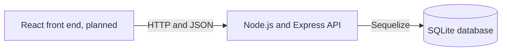
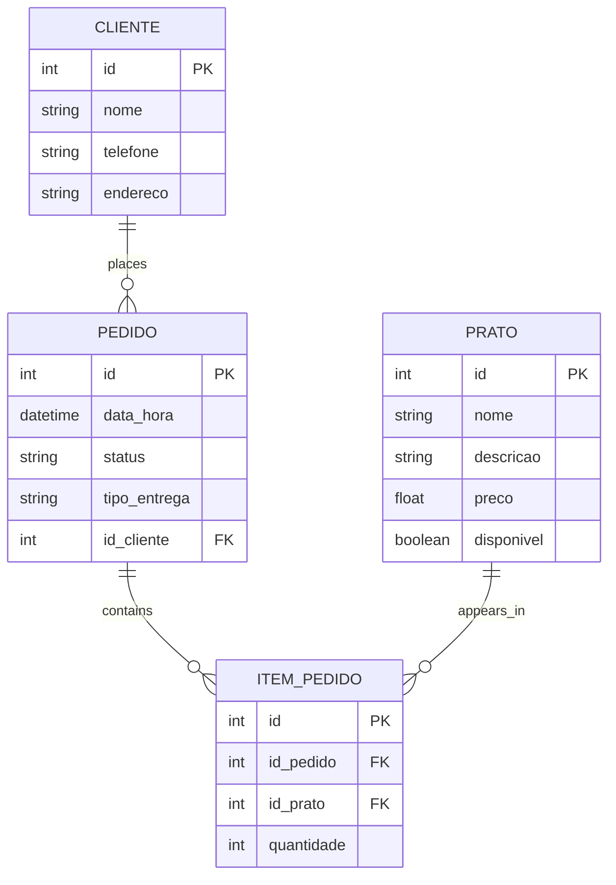

# Online Restaurant

A first-version online restaurant system for browsing a menu, placing delivery or pickup orders, and letting restaurant staff manage dishes and order progress.

This README combines the project flow and initial requirements from the group presentation with the backend routes currently implemented in `backend/index.js`. It distinguishes features in the code from planned account permissions so the documentation does not imply that authentication already exists.

## Project goals

The system aims to move an order through this flow:

1. A visitor views dishes that are available.
2. The customer registers their name, telephone number, and address.
3. The customer chooses dishes and quantities, then selects delivery or pickup.
4. The backend saves the order and all its items in SQLite as one transaction.
5. Restaurant staff view the order, its customer, dishes, and quantities.
6. Staff update the order status, and the customer checks the status using their customer ID.

The presentation describes a web front end in React, an API in Node.js and Express, and SQLite accessed through Sequelize. The current repository contains the backend implementation; a React front end is not included here.

## User stories and functionality

“Eu posso” means “I can.” The table describes the intended roles and what the current API provides for each one.

| User type | User story / Eu posso | Backend functionality | API route(s) | Current state |
|---|---|---|---|---|
| Visitor | I can browse the menu and see dish names, descriptions, and prices. | Lists available dishes; reads a dish by ID. | `GET /pratos`, `GET /pratos/:id` | Implemented. `GET /pratos` hides unavailable dishes by default. |
| Visitor | I can create a customer record before checkout. | Saves name, telephone, and address. | `POST /clientes` | Implemented as a database record; there is no password or login. |
| Visitor / Registered Client | I can place an order with one or more dishes and quantities. | Validates the customer, dish availability, fulfillment type, and quantities; saves the order and items together in a transaction. | `POST /pedidos` | Implemented. The request needs an existing `id_cliente`. |
| Visitor / Registered Client | I can choose delivery or pickup for an order. | Saves `tipo_entrega` as `entrega` or `retirada`. | `POST /pedidos` | Implemented. A delivery uses the address saved on the customer record. |
| Registered Client | I can view my saved contact and delivery details. | Reads and updates a customer record by ID. | `GET /clientes/:id`, `PUT /clientes/:id` | Implemented by ID. Identity is not verified. |
| Registered Client | I can see my order history and follow order status. | Lists orders for a customer ID, newest first, with dishes and quantities. | `GET /clientes/:id/pedidos` | Implemented by ID. There is no login check to ensure the caller owns that ID. |
| Registered Client | I can cancel an order. | Sets the order status to `cancelado` and preserves its order history. | `DELETE /pedidos/:id` | Implemented. Despite the HTTP method name, this route cancels rather than erases the order. |
| Restaurant Owner / Staff | I can add, edit, and remove dishes from the menu. | Dish CRUD; availability can be changed to hide a dish from the public menu. | `POST /pratos`, `GET /pratos?todos=true`, `PUT /pratos/:id`, `DELETE /pratos/:id` | Implemented. A dish referenced by order history cannot be deleted; mark it unavailable instead. |
| Restaurant Owner / Staff | I can view incoming orders with customer, dish, and quantity details. | Lists orders with associated customer and item/dish records. | `GET /pedidos`, `GET /pedidos/:id` | Implemented. The routes are currently public and have no staff permission check. |
| Restaurant Owner / Staff | I can update an order's progress. | Changes the status to one of the allowed values. | `PUT /pedidos/:id` | Implemented. Valid values are listed in [Order statuses](#order-statuses). |
| Restaurant Owner / Staff | I can review or correct order items. | Lists, reads, adds, updates, or removes an order line. | `/itens-pedido` routes | Implemented as CRUD endpoints. |

### Account and role limitation

The roles above describe the intended user experience. **The current backend does not implement accounts, passwords, sessions, tokens, or role-based access.** A “Registered Client” currently means a row in the `Clientes` table, not a person who has signed in. The API does not distinguish a visitor from a client or a restaurant employee.

As a result, a caller who can reach the API can currently list all orders and customers, request orders for any customer ID, edit dishes, and change order statuses. Add authentication and authorization before using the API with real customer data or exposing owner-only operations publicly.

## System architecture



The Express API listens on port `8080` by default. It stores `restaurante.db` beside `backend/index.js`, so the file location does not change based on the directory used to launch Node.js.

## Data model

The database follows the four-table structure in the presentation. Sequelize also adds `id`, `createdAt`, and `updatedAt` fields to each model.

| Table / model | Fields in the backend | Purpose |
|---|---|---|
| `Cliente` | `id`, `nome`, `telefone`, `endereco`, timestamps | Customer contact and saved delivery address. |
| `Prato` | `id`, `nome`, `descricao`, `preco`, `disponivel`, timestamps | Restaurant menu items and whether each may currently be ordered. |
| `Pedido` | `id`, `data_hora`, `status`, `tipo_entrega`, `id_cliente`, timestamps | Order owner, creation time, progress, and delivery or pickup choice. |
| `ItemPedido` | `id`, `id_pedido`, `id_prato`, `quantidade`, timestamps | Join table connecting orders to dishes and recording quantities. |



`tipo_entrega` is an additional order field needed to support the presentation's delivery-or-pickup flow. At startup, the backend adds this column to an older `Pedidos` table if it is missing. Existing historical rows may have a null fulfillment type; new orders must provide one.

## Order statuses

| Value | Meaning |
|---|---|
| `recebido` | The API has saved the order. This is the initial status. |
| `em_preparacao` | Restaurant staff are preparing the order. |
| `saiu_para_entrega` | The order is on its way to the customer. |
| `concluido` | The order is complete. |
| `cancelado` | The order has been cancelled. Its data remains in the database. |

`PUT /pedidos/:id` accepts only these values. The implementation validates the list of values but does not enforce a particular transition sequence between them.

## API reference

All routes accept and return JSON unless noted. The API currently has **no public/private or role-protected routes**; the “intended user” column describes the planned use, not an access-control rule.

### Health check

| Method | Path | Intended use | Notes |
|---|---|---|
| `GET` | `/` | Check whether the API process responds. | Returns a plain-text health message. |

### Dishes (`pratos`)

| Method | Path | Intended use | Notes |
|---|---|---|---|
| `POST` | `/pratos` | Owner/staff creates a dish. | `nome` and `preco` are required; `disponivel` defaults to `true`. |
| `GET` | `/pratos` | Visitor browses the menu. | Returns available dishes only. |
| `GET` | `/pratos?todos=true` | Owner/staff views all dishes. | Includes unavailable dishes; currently not protected by a role check. |
| `GET` | `/pratos/:id` | Read a dish by ID. | Returns `404` when it does not exist. |
| `PUT` | `/pratos/:id` | Owner/staff edits a dish or availability. | Allowed fields: `nome`, `descricao`, `preco`, `disponivel`. |
| `DELETE` | `/pratos/:id` | Owner/staff deletes a dish. | Fails with `409` when order history references the dish. Set `disponivel` to `false` to take it off the menu while retaining history. |

Example dish body:

```json
{
  "nome": "Feijoada",
  "descricao": "Prato individual",
  "preco": 35.5,
  "disponivel": true
}
```

### Customers (`clientes`)

| Method | Path | Intended use | Notes |
|---|---|---|---|
| `POST` | `/clientes` | Create a customer record before checkout. | Requires `nome`, `telefone`, and `endereco`; returns the generated `id`. |
| `GET` | `/clientes` | Owner/staff lists customers. | Returns all customer records; currently public. |
| `GET` | `/clientes/:id` | Read a customer's details. | Returns `404` when missing. |
| `GET` | `/clientes/:id/pedidos` | Customer tracks their orders. | Filters by the supplied customer ID and includes line items and dishes. The API does not authenticate ownership. |
| `PUT` | `/clientes/:id` | Update customer contact/address. | Allowed fields: `nome`, `telefone`, `endereco`. |
| `DELETE` | `/clientes/:id` | Delete a customer record. | Fails if order history references that customer. |

### Orders (`pedidos`)

| Method | Path | Intended use | Notes |
|---|---|---|---|
| `POST` | `/pedidos` | Customer submits an order. | Creates the order and all its items atomically. Requires at least one item, a valid customer, available dishes, positive integer quantities, and a fulfillment type. |
| `GET` | `/pedidos` | Owner/staff views received orders. | Includes customer, dish, and quantity information; currently public. |
| `GET` | `/pedidos/:id` | Read one order. | Includes customer, items, and dishes. |
| `PUT` | `/pedidos/:id` | Owner/staff updates progress. | Body must contain a valid `status`. Other order fields cannot be changed through this route. |
| `DELETE` | `/pedidos/:id` | Cancel an order. | Sets status to `cancelado`; does not remove the order or its items. |

Example new order:

```json
{
  "id_cliente": 1,
  "tipo_entrega": "entrega",
  "itens": [
    { "id_prato": 2, "quantidade": 2 },
    { "id_prato": 5, "quantidade": 1 }
  ]
}
```

Use `"tipo_entrega": "retirada"` for customer pickup. The backend uses the customer's saved `endereco` for delivery; the order does not store a separate address snapshot.

Example status update:

```json
{
  "status": "em_preparacao"
}
```

### Order items (`itens-pedido`)

These routes support the required CRUD operations and restaurant-side corrections. The normal customer checkout should use `POST /pedidos`, which saves the order and all its lines in one transaction.

| Method | Path | Intended use | Notes |
|---|---|---|---|
| `POST` | `/itens-pedido` | Add an item to an existing order. | Requires `id_pedido`, `id_prato`, and a positive integer `quantidade`. |
| `GET` | `/itens-pedido` | List items for review. | Includes parent order and dish information. |
| `GET` | `/itens-pedido/:id` | Read one item. | Includes its order and dish. |
| `PUT` | `/itens-pedido/:id` | Correct an item's order, dish, or quantity. | Quantity must be a positive integer. |
| `DELETE` | `/itens-pedido/:id` | Remove one item. | Returns `404` if the item is missing. |

## Validation and error responses

The API validates positive record IDs, required JSON object bodies, order item IDs, dish availability at checkout, fulfillment type, status, and positive integer quantities. It responds with:

| HTTP status | Meaning |
|---|---|
| `201` | A dish, customer, order, or item was created. |
| `200` | A read, update, cancellation, or deletion completed. |
| `400` | Request data is invalid. |
| `404` | The requested record does not exist. |
| `409` | A related record prevents the requested deletion. |
| `500` | An unexpected server error occurred. |

Order creation uses a database transaction: if validating or saving any item fails, the order and its items are rolled back together.

## Running the backend

Requirements: a supported Node.js installation and working `npm` installation for the dependencies, including the native SQLite module.

In PowerShell:

```powershell
cd backend
npm install
node index.js
```

The API uses `http://localhost:8080` by default. To use a different port in PowerShell:

```powershell
$env:PORT = "8081"
node index.js
```

The database is created at `backend/restaurante.db`. The `.gitignore` excludes `.db` files so local customer/order data is not committed accidentally. Sequelize creates missing tables on startup and adds the `tipo_entrega` column if an older `Pedidos` table does not have it.

There is no configured automated test suite yet. `backend/package.json` currently contains a placeholder `test` script.

## Current implementation boundaries

- The React screens, menu cart, login pages, and owner dashboard are described by the presentation but are not included in this repository's current backend project files.
- Login, password storage, session/token handling, and owner-versus-customer authorization are not implemented.
- No payment processing, stock/inventory count, delivery assignment, estimated delivery time, email/SMS notifications, or real-time push updates are included.
- Customer tracking is an HTTP read route; a front end would need to refresh/poll it to show status changes.
- Orders store dishes and quantities but do not store a price snapshot or calculated total. A changed menu price can therefore affect what a client displays later unless the front end snapshots or the schema is extended.
- The API has no authentication-based privacy boundary yet. Do not expose it publicly with real customer information until that is added.

## Runtime note

The source passes `node --check`, but the current development environment could not start the API because its installed `sqlite3` native binding reported that it was not a valid Win32 application. This is a local dependency/runtime issue, not proof that the database configuration has connected successfully. Reinstall or rebuild the backend dependencies on the target Windows/Node.js environment, then start the server and confirm the health route and database-backed requests.
